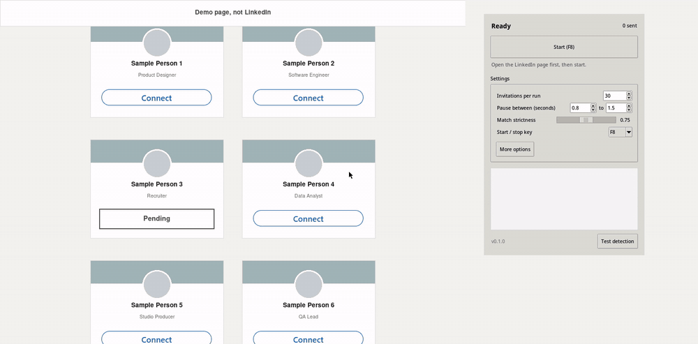

# auto-linkdn-connect

Looks at your screen, clicks the first **Connect** button from the top, confirms with **Send without a note**, and repeats. When no Connect button is left on screen it scrolls down and keeps going.



The recording is the real app running against a local demo page, not LinkedIn. [Full quality video](docs/demo.mp4).

It reads pixels and moves the mouse, so it works with any browser and needs no login, token or extension.

## Windows download

Get `auto-linkdn-connect.exe` from the [latest release](../../releases/latest). It needs no Python and no install: run it.

- Windows SmartScreen may say the app is unrecognized because the file is not code signed. Choose **More info**, then **Run anyway**.
- Some antivirus programs flag any program that clicks and reads the keyboard. If yours does, run from source below instead.
- The single file unpacks itself on every start, so the window takes a few seconds to appear.
- `auto-linkdn-connect.exe --self-test report.txt` checks the install without opening the window.

## Install from source

You need Python 3.9 or newer with Tk. It is tested on 3.14.

```sh
git clone https://github.com/YatoVoid/auto-linkdn-connect
cd auto-linkdn-connect
python -m venv .venv
```

Activate the environment, then install:

| Windows | macOS and Linux |
|---|---|
| `.venv\Scripts\activate` | `source .venv/bin/activate` |

```sh
pip install .
python -m linkdn_connect
```

Tk comes with Python on Windows and macOS. On Linux install it from your package manager if it is missing: `python3-tk` (Debian, Ubuntu), `python3-tkinter` (Fedora), `tk` (Arch).

### Platform notes

| System | What to do |
|---|---|
| Windows 10, 11 | Nothing. |
| macOS | In System Settings, Privacy and Security, allow your terminal (or Python) under Screen Recording, Accessibility and Input Monitoring. |
| Linux, X11 | Nothing. |
| Linux, Wayland | Install a screenshot tool: `spectacle` (KDE), `gnome-screenshot` (GNOME) or `grim` (Sway, Hyprland). Add yourself to the `input` group with `sudo usermod -aG input $USER` and log in again. Clicks and the start/stop key go through `/dev/uinput`. |

Not every system has been run on real hardware:

| System | Status |
|---|---|
| Linux, X11 | Run end to end in an X server: capture, clicks, scrolling, hotkey. |
| Linux, Wayland | Capture, pointer placement, clicks, scrolling and key reading checked separately on KDE Plasma. No full run yet. |
| Windows | The tests pass on a Windows runner, and the built exe passes its self-test there, including screen capture and mouse setup. Not yet run against a real browser. |
| macOS | Same libraries as X11, covered by the automated tests, not run on a real machine. |

## Use

1. Open a LinkedIn page that lists people with Connect buttons, such as search results or My Network. Keep the browser window visible.
2. Click **Start** or press **F8**. After a 3 second countdown the window minimizes and the run begins.
3. Press **F8** again to stop. On Windows, macOS and X11 you can also stop by moving the mouse.

The run ends by itself when it reaches the invitation limit, the bottom of the page, or four failed attempts in a row.

**Test detection** takes a screenshot and lists what the matcher sees, with scores, without clicking anything. Use it to check the setup before a run.

## Settings

| Setting | Default | |
|---|---|---|
| Invitations per run | 30 | Stops after this many. |
| Pause between | 3 to 7 s | A random wait after each invitation. |
| Match strictness | 0.75 | Lower finds more, higher is pickier. |
| Start / stop key | F8 | F6 to F12. |
| Scroll step | 5 | Mouse wheel clicks per scroll. |
| Monitor | 1 | Which screen to watch on Windows, macOS and X11. |
| Connect image, Send image | built in | See below. |

Settings are saved to `%APPDATA%\linkdn-connect\settings.json` on Windows and `~/.config/linkdn-connect/settings.json` elsewhere.

## Dark mode and other languages

The built in images are the light theme buttons in English. For anything else, take a screenshot of the whole button, then pick it under **More options**, **Connect image** or **Send image**. The tool cuts out the label by itself and matches it at any browser zoom between 60% and 160%.

## How it works

1. Take a screenshot.
2. Search it for the Connect label with template matching at many zoom levels, and keep only matches with the same colour as the template, so grey buttons such as Pending are ignored.
3. Click the first one, reading top to bottom and left to right.
4. Wait up to 4 seconds for Send without a note and click it. If a different dialog appears, press Escape and skip that button.
5. With no Connect button left, scroll and look again. If the page stops moving after three tries, it is the end.

## Limits

- LinkedIn's terms forbid automated tools, and an account that sends many invitations can be warned or restricted. LinkedIn also caps weekly invitations and shows a dialog when you reach it. The defaults are cautious. Use it at your own risk.
- It clicks every Connect button it sees. It does not read names or filter people.
- It does not press Show more buttons. It only scrolls.
- On Wayland it cannot detect that you moved the mouse, so stop it with the key.
- On Wayland with several monitors, the whole desktop is treated as one screen.

## Development

```sh
pip install -e ".[dev]"
pytest
```

The tests drive the engine against a simulated page that renders real frames and answers clicks, scrolls and Escape. `tests/e2e/run_x11.py` repeats that against a real X server and needs `Xephyr`. `tools/record_demo.py` regenerates the recording above and needs `Xephyr` and `ffmpeg`. `tests/e2e/run_wayland.py` does the same on a Wayland desktop. It covers the whole screen with a test page and takes over the mouse for about a minute, so run it when you are not using the machine.

## License

MIT
